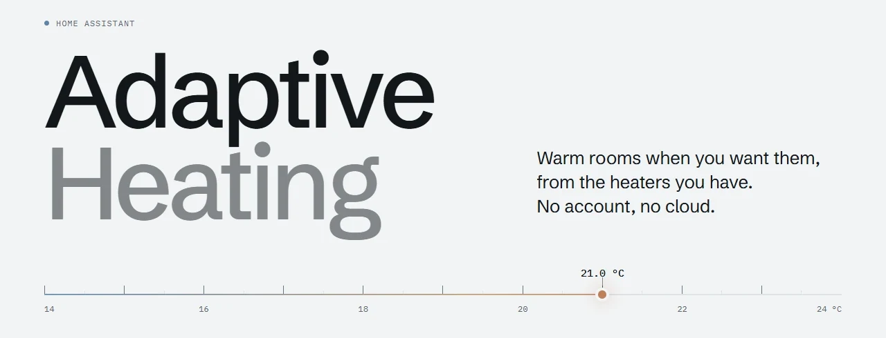
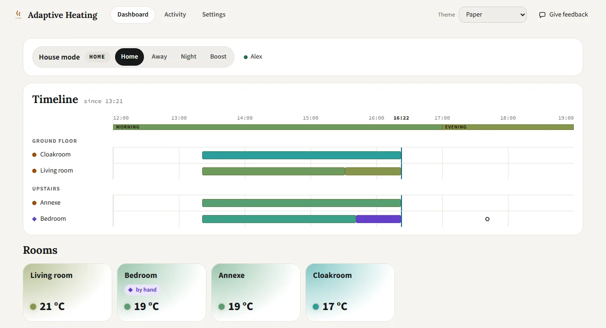
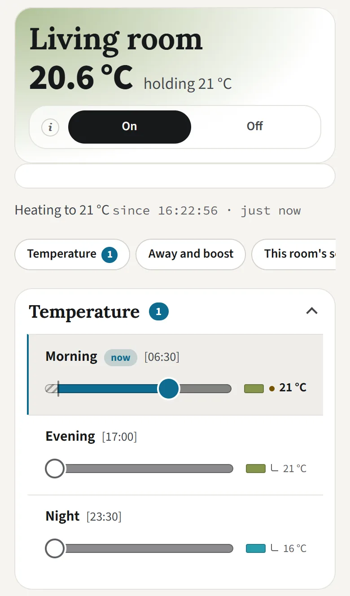
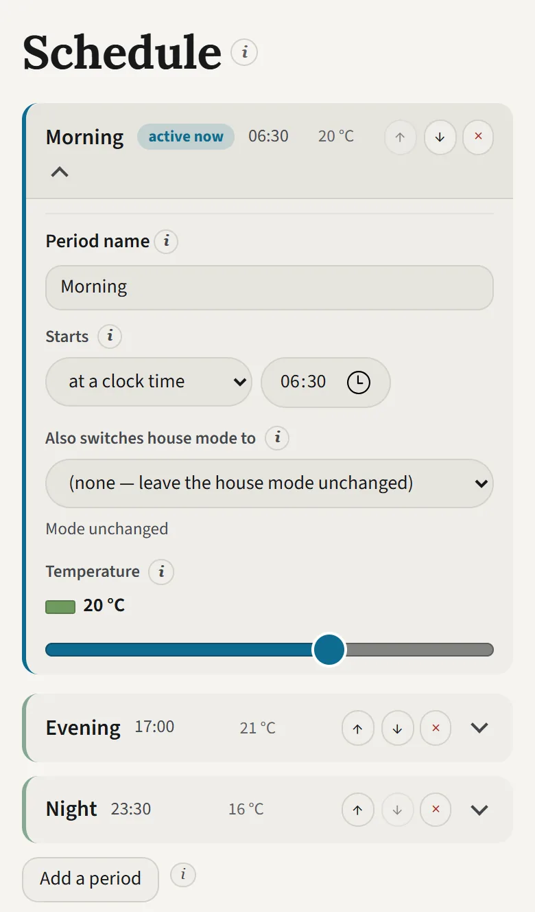
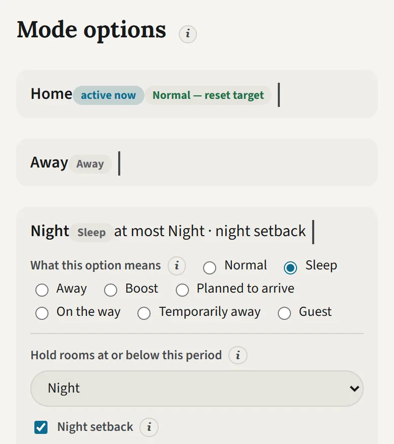
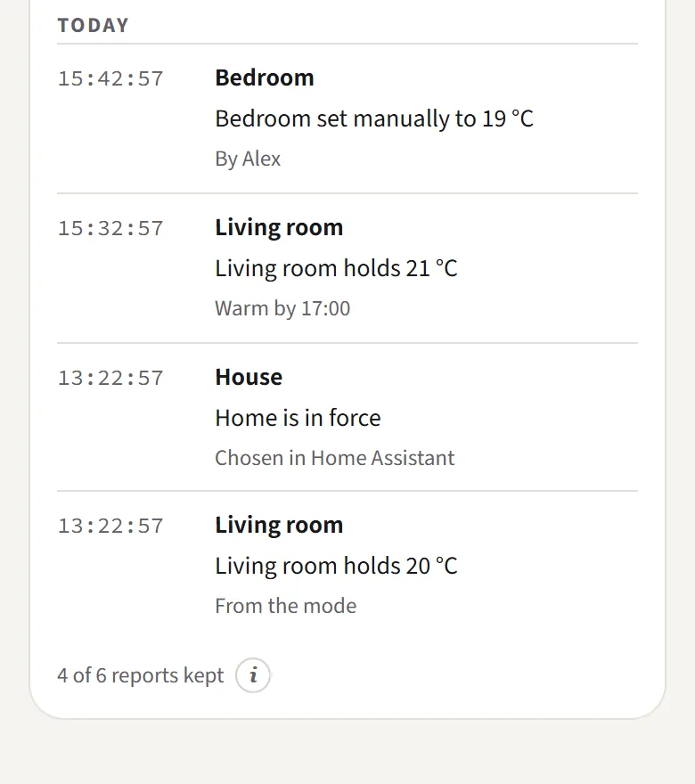

<picture>
  <source media="(prefers-color-scheme: dark)" srcset="docs/images/hero-dark.webp">
  
</picture>

<h3 align="center">Every room warm on time. Cooler when nobody needs the heat.</h3>

<picture>
  <source media="(prefers-color-scheme: dark)" srcset="docs/images/dashboard-dark.webp">
  
</picture>

<table>
  <tr>
    <td width="50%" valign="top" align="center">
      <picture>
        <source media="(prefers-color-scheme: dark)" srcset="docs/images/room-dark.webp">
        
      </picture>
       A room's day
    </td>
    <td width="50%" valign="top" align="center">
      <picture>
        <source media="(prefers-color-scheme: dark)" srcset="docs/images/schedule-dark.webp">
        
      </picture>
       The schedule
    </td>
  </tr>
  <tr>
    <td width="50%" valign="top" align="center">
      <picture>
        <source media="(prefers-color-scheme: dark)" srcset="docs/images/house-modes-dark.webp">
        
      </picture>
       House modes
    </td>
    <td width="50%" valign="top" align="center">
      <picture>
        <source media="(prefers-color-scheme: dark)" srcset="docs/images/activity-dark.webp">
        
      </picture>
       Plain answers
    </td>
  </tr>
</table>

## What it does

- **Warm on time.** Set 20 °C for 06:30. Each room learns when to start.
- **Cooler at night.** Warm again by morning in any room with a power meter.
- **One switch for the house.** Pick Home, Away, Sleep or Guests in Home Assistant.
- **Warm for arrivals.** A calendar arrival warms the house first.
- **A room of its own.** A thermostat preset lasts until the next part of the day.
- **Safe when something fails.** An open window stops the heating. A flat sensor battery leaves no room cold.
- **Plain answers.** Each room says why it heats or not.
- **Stays at home.** No account, no cloud.

## Install

The integration gives each room a thermostat. The app holds the schedule and settings.

1. In **Settings → Marketplace**, install **Adaptive Heating**.
2. Open **Settings → Apps → Repositories** and add `https://github.com/0z00z0/ha-adaptive-heating-app`, or [add it in one step](https://my.home-assistant.io/redirect/supervisor_add_addon_repository/?repository_url=https%3A%2F%2Fgithub.com%2F0z00z0%2Fha-adaptive-heating-app).
3. Install the app and start it.
4. Give each room's heaters and temperature sensors the label `heating`.

Needs Home Assistant 2026.11 or newer. The app also needs the Supervisor and a 64-bit board.

[Landing page](https://0z0.xyz/adaptive-heating) · [Issues](https://github.com/0z00z0/ha-adaptive-heating/issues) · MIT licence
